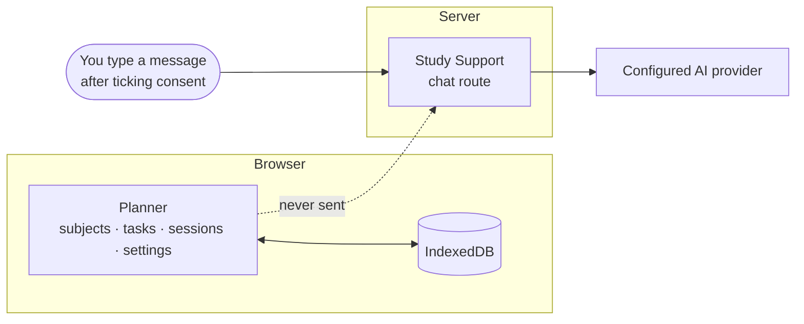
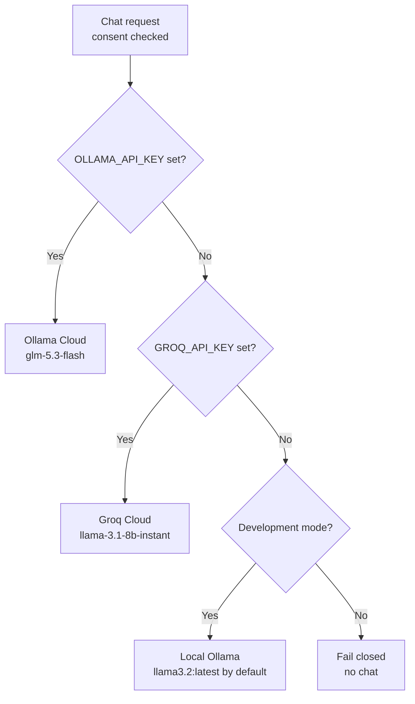

<p align="center">
  
</p>

<h3 align="center">Plan the day. Protect the focus.</h3>

<p align="center">
  Your tasks never leave your browser.<br/>
  AI help is opt-in, consent-first, and fails closed.
</p>

<p align="center">
  
  
  
  
  
</p>

<p align="center">
  <a href="#quick-start"><b>Quick start</b></a> &nbsp;·&nbsp;
  <a href="#the-planner">Planner</a> &nbsp;·&nbsp;
  <a href="#study-support">Study Support</a> &nbsp;·&nbsp;
  <a href="#privacy">Privacy</a> &nbsp;·&nbsp;
  <a href="#deploy-on-vercel">Deploy</a> &nbsp;·&nbsp;
  <a href="#testing">Testing</a>
</p>

<br/>

## The idea

Most study apps ask you to hand over your whole life first. **Daybreak asks for nothing.**

It is built as two halves that stay deliberately apart:

|  | **The Planner** | **Study Support** |
|:--|:--|:--|
| **What it does** | Keeps your subjects, tasks and focus sessions | An AI chat for study questions |
| **Where data lives** | Your browser's IndexedDB | Nowhere. Chats are not stored |
| **Account needed** | No | No |
| **Can be ignored** | It's the app | Completely |
| **Sees the other half** | Never | Never. It only sees what you type |

> The AI cannot see your planner, and your planner never needs the AI.

<br/>

## At a glance

| | |
|:--|:--|
| **Planner** | Static app in `public/planner/`, served at `/planner/` |
| **Support page** | Next.js, served at `/` |
| **Your data** | Subjects, tasks, focus sessions and settings in browser IndexedDB |
| **AI providers** | Ollama Cloud → Groq Cloud → local Ollama (development only) |
| **Consent** | Messages are sent only after the consent box is checked |
| **Production default** | Chat fails closed if anything is missing |
| **Requires** | Node.js 20.9 or newer |

<br/>

## Quick start

```bash
npm install
npm run dev
```

Open **<http://localhost:3000>**.

| Address | What you get |
|:--|:--|
| `/` | The Next.js Study Support page |
| `/planner/` | The planner, preserved as its own static app |

To turn on the chat, set `AI_CHAT_ENABLED=true` and restart Daybreak. Provider setup is covered in [Study Support](#study-support).

<br/>

## The planner

Static, local-first, and entirely yours. Everything you enter stays in this browser's IndexedDB.

**Included**

- Task and subject management with quick add
- Daily productivity tips
- A customizable focus timer
- Optional focus sounds with volume controls
- Appearance settings
- JSON backup and restore

**Good to know**

- **Sounds are off until you start them.** They are generated in your browser. Nothing is streamed or uploaded.
- **Migration is careful.** It keeps the old `studyloop.v1` value plus a safety copy, so nothing is lost on the way over.
- **Music is your call.** An optional YouTube Music search link opens in a new tab, and you control playback on that service.

<br/>

## Where your data lives



Only the message you type travels to the AI. The planner stays on the other side of the line.

<br/>

## Study Support

An optional chat for study questions.

> [!IMPORTANT]
> Study Support is **not** a therapist, clinician or emergency service.

**How it behaves**

- Knows the current Singapore Time (SGT, UTC+08:00) date and time, so it can reason about deadlines.
- Recognizes Daybreak's quick-add tags.
- **Cannot read or edit your planner tasks**, and must not claim to.
- Chats are **not stored** in planner storage.

### Provider priority

Daybreak uses the first provider it finds configured.



| Priority | Provider | Key or setting | Model |
|:-:|:--|:--|:--|
| **1** | Ollama Cloud | `OLLAMA_API_KEY` | `glm-5.3-flash` |
| **2** | Groq Cloud | `GROQ_API_KEY` | `llama-3.1-8b-instant` |
| **3** | Local Ollama *(development only)* | `OLLAMA_MODEL` | `llama3.2:latest` by default |

> [!WARNING]
> Never expose provider credentials with a `NEXT_PUBLIC_` prefix. Keys stay on the server.

<details>
<summary><b>Environment variables</b></summary>

<br/>

| Variable | Purpose |
|:--|:--|
| `AI_CHAT_ENABLED` | Set to `true` to turn the chat on |
| `OLLAMA_API_KEY` | Ollama Cloud key, server-side only |
| `GROQ_API_KEY` | Groq Cloud key, server-side only |
| `OLLAMA_BASE_URL` | Optional local URL, e.g. `http://127.0.0.1:11434/v1` |
| `OLLAMA_MODEL` | Optional local model, default `llama3.2:latest` |
| `UPSTASH_REDIS_REST_URL` | Rate limiting, hosted chat only |
| `UPSTASH_REDIS_REST_TOKEN` | Rate limiting, hosted chat only |

</details>

<br/>

## Privacy

| Promise | How Daybreak keeps it |
|:--|:--|
| **Consent comes first** | Messages go to a provider only after the user checks the consent box |
| **Your planner stays yours** | Planner data is never included in a chat request |
| **No chat history in the planner** | Chats are not stored in planner storage |
| **Keys stay on the server** | Cloud requests use server-side keys |
| **No direct browser-to-Ollama traffic** | The browser talks to Daybreak, and Daybreak talks to the provider |
| **Local fallback is loopback-only** | Only loopback URLs are accepted, and it is unavailable in production |
| **No wildcard origins** | Do not set `OLLAMA_ORIGINS=*` |
| **Sounds stay local** | Focus sounds are generated in the browser and never uploaded |

<br/>

## Set up local Ollama

For development without a cloud key. Use separate terminal windows.

<details>
<summary><b>Show the 5 steps</b></summary>

<br/>

**1. Pull the model**

```bash
ollama pull llama3.2:latest
```

**2. Start Ollama** *(skip if the desktop app is already running it)*

```bash
ollama serve
```

**3. In another terminal, create your env file**

```bash
cp .env.example .env.local
```

**4. Enable the chat in `.env.local`**

```text
AI_CHAT_ENABLED=true
```

**5. Start Daybreak**

```bash
npm run dev
```

Optional: `OLLAMA_BASE_URL=http://127.0.0.1:11434/v1` and `OLLAMA_MODEL=llama3.2:latest`. No `OLLAMA_ORIGINS` setting is needed. The `qwen2.5-coder:7b` model is optional and is not used by Study Support.

</details>

<br/>

## Deploy on Vercel

For hosted chat, add these under Vercel's **server-side** project environment settings:

```text
AI_CHAT_ENABLED=true
OLLAMA_API_KEY=...            # or GROQ_API_KEY=...
UPSTASH_REDIS_REST_URL=...
UPSTASH_REDIS_REST_TOKEN=...
```

**What production does**

- Uses the selected cloud provider and **never** falls back to local Ollama.
- Limits each IP to **8 messages per 10 minutes** using Upstash.
- Shows a consent notice explaining that messages go to the configured cloud provider.
- **Fails closed** if the cloud key or the rate-limit configuration is missing.

<br/>

## Testing

| Command or page | What it checks |
|:--|:--|
| `npm run test:api` | Chat-request validation, fail-closed configuration, and deployment asset and module paths |
| `/planner/tests/index.html` | A dependency-free browser suite, run inside the running app |
| `npm run build` | The production Next.js build |

> [!NOTE]
> The browser suite uses a randomly named temporary IndexedDB database. It does not read or modify planner localStorage, so running it can't touch your real data.

<br/>

---

<p align="center">
  
</p>

<p align="center">
  <b>Daybreak</b> &nbsp;·&nbsp; made by <a href="https://github.com/Poohkao2026-beep">@Poohkao2026-beep</a><br/>
  <sub>Start the day on your own terms.</sub>
</p>

<p align="center">
  
</p>
