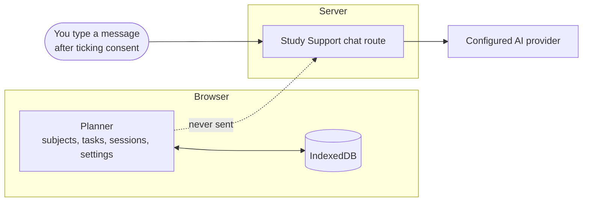
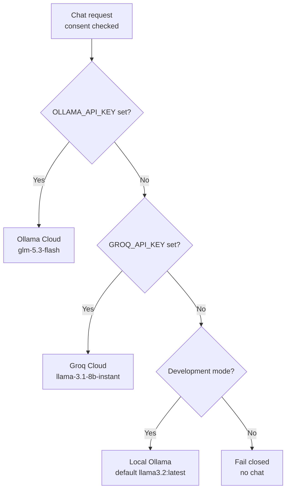

<p align="center">
  
</p>

<p align="center">
  <a href="https://github.com/Poohkao2026-beep">
    
  </a>
</p>

<p align="center">
  
  
  
  
  
</p>

<p align="center">
  <a href="#run-it-locally">Run it</a> &middot;
  <a href="#the-planner">Planner</a> &middot;
  <a href="#study-support">Study Support</a> &middot;
  <a href="#privacy-promises">Privacy</a> &middot;
  <a href="#deploy-on-vercel">Deploy</a> &middot;
  <a href="#testing">Testing</a>
</p>

---

## The idea

Most study apps ask you to hand over your whole life first. Daybreak asks for nothing.

It has two halves that stay deliberately apart:

- **The planner** keeps your subjects, tasks and focus sessions in your own browser. No account and no upload.
- **Study Support** is an AI chat you can ignore completely. If you turn it on, it only sees what you type into it, and only after you tick the consent box.

The AI cannot see your planner, and your planner never needs the AI.

---

## At a glance

| | |
|:--|:--|
| **What it is** | A local-first study planner plus an opt-in AI study chat |
| **Planner** | Static app in `public/planner/`, served at `/planner/` |
| **Support page** | Next.js, served at `/` |
| **Your data** | Subjects, tasks, focus sessions and settings in browser IndexedDB |
| **AI providers** | Ollama Cloud, then Groq Cloud, then local Ollama (dev only) |
| **Consent** | Messages are sent only after the user checks the consent box |
| **Production default** | Chat fails closed if anything is missing |
| **Needs** | Node.js 20.9 or newer |

---

## Run it locally

```bash
npm install
npm run dev
```

Open <http://localhost:3000>.

| Address | What you get |
|:--|:--|
| `/` | The Next.js Study Support page |
| `/planner/` | The planner, preserved as its own static app |

To turn on the chat, set `AI_CHAT_ENABLED=true` and restart Daybreak. Provider setup is covered in [Study Support](#study-support).

---

## The planner

The planner is static and local-first. It lives under `public/planner/`, and everything you enter stays in this browser's IndexedDB.

**What's inside**

- Task and subject management, with quick add
- Daily productivity tips
- A customizable focus timer
- Optional focus sounds generated in the browser, with volume controls
- Appearance settings
- JSON backup and restore

**Details worth knowing**

- **Sounds are off until you start them.** They are generated in your browser, not streamed and not uploaded.
- **Migration is careful.** It keeps the old `studyloop.v1` value and a safety copy, so nothing is lost on the way over.
- **Music is your call.** An optional YouTube Music search link opens in a new tab. You control playback on that service.

---

## Where your data lives



Only the message you type travels to the AI. The planner stays on the other side of the line.

---

## Study Support

Study Support is an optional chat for study questions. It is **not a therapist, clinician or emergency service.**

### How it behaves

- It knows the current Singapore Time (SGT, UTC+08:00) date and time, so it can reason about deadlines.
- It recognizes Daybreak's quick-add tags.
- It **must not claim to read or edit your planner tasks.** It can't.
- Chats are **not stored** in planner storage.

### Provider priority

Daybreak picks the first provider it finds configured:



| Priority | Provider | Key or setting | Model |
|:-:|:--|:--|:--|
| 1 | Ollama Cloud | `OLLAMA_API_KEY` | `glm-5.3-flash` |
| 2 | Groq Cloud | `GROQ_API_KEY` | `llama-3.1-8b-instant` |
| 3 | Local Ollama (development only) | `OLLAMA_MODEL` | `llama3.2:latest` by default |

> **Never** expose provider credentials with a `NEXT_PUBLIC_` prefix. Keys stay on the server.

### Environment variables

| Variable | Purpose |
|:--|:--|
| `AI_CHAT_ENABLED` | Set to `true` to turn the chat on |
| `OLLAMA_API_KEY` | Ollama Cloud key, server-side only |
| `GROQ_API_KEY` | Groq Cloud key, server-side only |
| `OLLAMA_BASE_URL` | Optional local URL, e.g. `http://127.0.0.1:11434/v1` |
| `OLLAMA_MODEL` | Optional local model, default `llama3.2:latest` |
| `UPSTASH_REDIS_REST_URL` | Rate limiting, hosted chat only |
| `UPSTASH_REDIS_REST_TOKEN` | Rate limiting, hosted chat only |

---

## Privacy promises

| Promise | How Daybreak keeps it |
|:--|:--|
| **Consent comes first** | Messages go to a provider only after the user checks the consent box |
| **Your planner stays yours** | Planner data is never included in a chat request |
| **No chat history in the planner** | Chats are not stored in planner storage |
| **Keys stay on the server** | Cloud requests use server-side keys |
| **The browser never talks to Ollama directly** | It talks to Daybreak, which talks to the provider |
| **Local fallback is locked to loopback** | Only loopback URLs are accepted, and it is unavailable in production |
| **No wildcard origins** | Do not set `OLLAMA_ORIGINS=*` |
| **Sounds stay local** | Focus sounds are generated in the browser and never uploaded |

---

## Set up local Ollama

For development without a cloud key. Use separate terminal windows.

**1. Pull the model**

```bash
ollama pull llama3.2:latest
```

**2. Start Ollama** (skip this if the desktop app is already running it)

```bash
ollama serve
```

**3. In another terminal, create your env file**

```bash
cp .env.example .env.local
```

**4. Open `.env.local` and change the flag**

```text
AI_CHAT_ENABLED=true
```

**5. Start Daybreak**

```bash
npm run dev
```

Optional settings are `OLLAMA_BASE_URL=http://127.0.0.1:11434/v1` and `OLLAMA_MODEL=llama3.2:latest`. No `OLLAMA_ORIGINS` setting is needed. The `qwen2.5-coder:7b` model is optional and is not used by Study Support.

---

## Deploy on Vercel

For hosted chat, add these in Vercel's **server-side** project environment settings:

```text
AI_CHAT_ENABLED=true
OLLAMA_API_KEY=...            # or GROQ_API_KEY=...
UPSTASH_REDIS_REST_URL=...
UPSTASH_REDIS_REST_TOKEN=...
```

What production does:

- Uses the selected cloud provider, and **never** falls back to local Ollama.
- Limits each IP to **8 messages per 10 minutes** using Upstash.
- Shows a consent notice explaining that messages go to the configured cloud provider.
- **Fails closed** if the cloud key or the rate-limit configuration is missing.

---

## Testing

| Command or page | What it checks |
|:--|:--|
| `npm run test:api` | Chat-request validation, fail-closed configuration, and deployment asset and module paths |
| `/planner/tests/index.html` | A dependency-free browser suite, run inside the running app |
| `npm run build` | The production Next.js build |

The browser suite uses a randomly named temporary IndexedDB database. It does not read or modify planner localStorage, so running it can't touch your real data.

---

<p align="center">
  
</p>

<p align="center">
  <strong>Daybreak</strong> &middot; built by <a href="https://github.com/Poohkao2026-beep">@Poohkao2026-beep</a><br/>
  <sub>Start the day on your own terms.</sub>
</p>

<p align="center">
  
</p>
